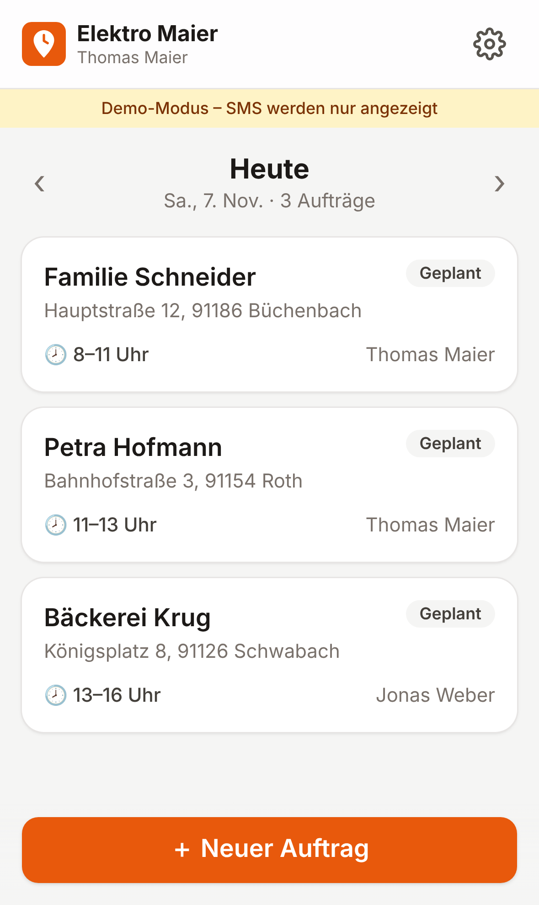
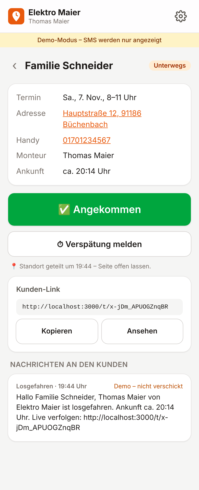
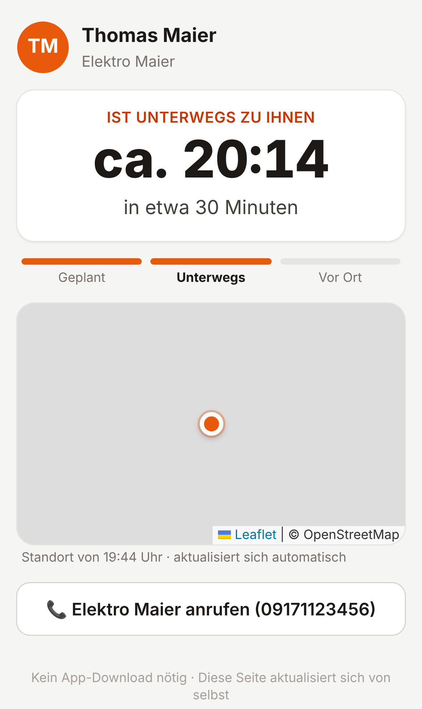

# Kommt gleich – Handwerker-Ankunfts-Link

*Arbeitstitel · Lukas Technology*

Der Handwerker tippt auf **„Losgefahren“**. Der Kunde bekommt eine SMS mit Link und sieht darin, wer kommt und wann er ungefähr ankommt (auf Wunsch mit Live-Karte). Der Kunde braucht **keine App**.

## So sieht es auf dem iPhone aus

| Tagesliste | Unterwegs | Kundenseite |
|---|---|---|
|  |  |  |

Alle Screenshots liegen in [`screenshots/`](screenshots/). Neu erzeugen: App starten, dann `npm run screenshots` ausführen.

## iPhone-Vorschau auf dem PC

```bash
npm install
npm run iphone     # startet die App und öffnet http://localhost:3000/iphone
```

Zwei iPhones nebeneinander: links die Handwerker-App, rechts die Kundenseite. Sobald links ein Kundenlink auftaucht, öffnet er sich rechts automatisch. In Claude Code gibt es dafür den Skill `iphone-vorschau`.

## Prüfen

| Befehl | Was |
|---|---|
| `npm run check` | Typen + Build |
| `npm run smoke` | Rauchtest gegen die laufende App |
| GitHub Actions „Prüfen“ | läuft bei jedem Push automatisch |

## Funktionen (Stufe 1, MVP)

- Betrieb registrieren, Login, Mitarbeiter anlegen
- Tagesliste mit Blättern zwischen den Tagen
- Auftrag anlegen: Kunde, Handynummer, Adresse, Zeitfenster, Monteur
- **Losgefahren**: Fahrzeit wählen (10–60 Min), dann bekommt der Kunde eine SMS mit Link
- **Verspätung melden**: Der Kunde bekommt eine SMS mit der neuen Uhrzeit
- **In 15 Minuten da**: Diese SMS geht automatisch raus (bei Fahrten über 20 Min)
- **Angekommen / Erledigt**: Danach läuft der Kundenlink ab
- **Kunde kann antworten**: „Passt, ich bin da“, „Bitte vorher kurz anrufen“ oder ein kurzer Hinweis (z. B. Klingel kaputt). Der Handwerker sieht das im Auftrag und in der Tagesliste, der Kunde sieht „gelesen“
- **Website des Betriebs** (optional) als Link auf der Kundenseite. Ohne Website zeigt die App das Angebot „Website bauen lassen“ (nur wenn `KONTAKT_EMAIL` gesetzt ist)
- Kundenseite aktualisiert sich selbst, mit Live-Karte (im Betrieb abschaltbar) und Anruf-Knopf
- Als Web-App zum Home-Bildschirm hinzufügbar

## Technik

| Teil | Lösung |
|---|---|
| App | Next.js 15 (React, TypeScript), Tailwind CSS |
| Datenbank | Postgres: lokal/Demo **PGlite** (eingebaut), im Echtbetrieb **Supabase** |
| SMS | seven.io (ohne API-Schlüssel: Demo, SMS wird nur in der App angezeigt) |
| Karte | Leaflet + OpenStreetMap |
| Später | native iOS/Android-App per Capacitor (Hintergrund-GPS) |

Wichtige Dateien:
- `db/schema.sql`: Datenmodell
- `src/lib/auftraege.ts`: Ablauf (Losfahren, Verspätung, 15-Minuten-SMS)
- `src/lib/sms.ts`: SMS-Versand
- `src/app/app/…`: Handwerker-App
- `src/app/t/[token]/…`: Kundenseite

## Lokal starten

```bash
npm install
npm run dev        # http://localhost:3000
```

Im Demo-Modus sind die Zugangsdaten schon eingetragen: `demo@lukas-technology.de` / `demo1234`.

## Auf dem echten iPhone ansehen (Vercel, kostenlos)

1. Auf [vercel.com](https://vercel.com) mit GitHub anmelden.
2. „Add New… → Project“ wählen, das Repo `handwerker-ankunfts-link` importieren und „Deploy“ drücken.
3. Du bekommst eine Adresse wie `https://handwerker-ankunfts-link.vercel.app`. Die auf dem iPhone in Safari öffnen, dann **Teilen → Zum Home-Bildschirm**.
4. Jeder Push auf einen Branch bekommt automatisch eine eigene Vorschau-Adresse.

**Wichtig:** Vercel startet die App auf mehreren Servern gleichzeitig. Ohne eigene Datenbank hätte jeder Server seine eigenen Demo-Daten, und Links würden manchmal ins Leere laufen. Deshalb vor dem Deploy eine **kostenlose Supabase-Datenbank** anlegen und `DATABASE_URL` sowie `AUTH_SECRET` setzen (siehe unten). Danach einfach in der App „Betrieb registrieren“ wählen. SMS bleiben im Demo-Modus, solange kein `SEVEN_API_KEY` gesetzt ist.

## Echtbetrieb einschalten

Diese Umgebungsvariablen setzen (bei Vercel unter Settings → Environment Variables), Vorlage siehe `.env.example`:

| Variable | Wofür |
|---|---|
| `DATABASE_URL` | Supabase (Region Frankfurt) → Connection string „Transaction pooler“ |
| `AUTH_SECRET` | lange Zufallszeichenkette für die Login-Cookies |
| `SEVEN_API_KEY` | echte SMS über seven.io |
| `APP_URL` | eigene Domain für den Link in der SMS |
| `CRON_SECRET` | schützt `/api/cron`. Diese Adresse jede Minute aufrufen, z. B. mit cron-job.org und dem Header `Authorization: Bearer <CRON_SECRET>` |

Die Tabellen werden beim ersten Start automatisch angelegt.

## Nächste Schritte

- **Stufe 2:** Ankunftszeit automatisch aus Standort und Adresse berechnen (OpenRouteService), Kunden-Adresse auf der Karte
- **Stufe 3:** native App mit Capacitor, damit der Standort auch bei gesperrtem Handy geteilt wird
- Datenschutz: Impressum und Datenschutzerklärung, automatisches Löschen alter Telefonnummern, Vertrag zur Auftragsverarbeitung mit seven.io
- Abrechnung (z. B. Stripe) und Tarife je nach Betriebsgröße
